<p align="center">
  <picture>
    <source media="(prefers-color-scheme: dark)" srcset="docs/media/banner-dark.png">
    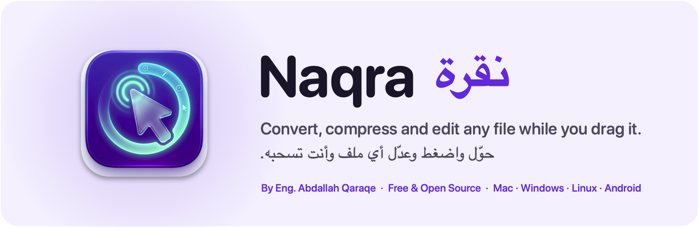
  </picture>
</p>

<p align="center">
  <b>English</b> · <a href="README.ar.md">العربية</a>
</p>


<p align="center">
  <a href="https://github.com/abdallahqaraqe1/naqra/releases/latest"></a>
  
  
  
  
  <a href="LICENSE"></a>
</p>

---

**Naqra** (أدوات, "tools") lives in your Mac's menu bar, next to the Windows clock, or in the Linux top bar. Start dragging any file,
press a key, and a wheel of choices opens right under the pointer. Drop the file on a choice and it is done: a new
format, a smaller size, an edited copy. No upload, no account, no limits. Everything happens on your computer.
On Android, share any file to Naqra and the same wheel opens.

<p align="center">
  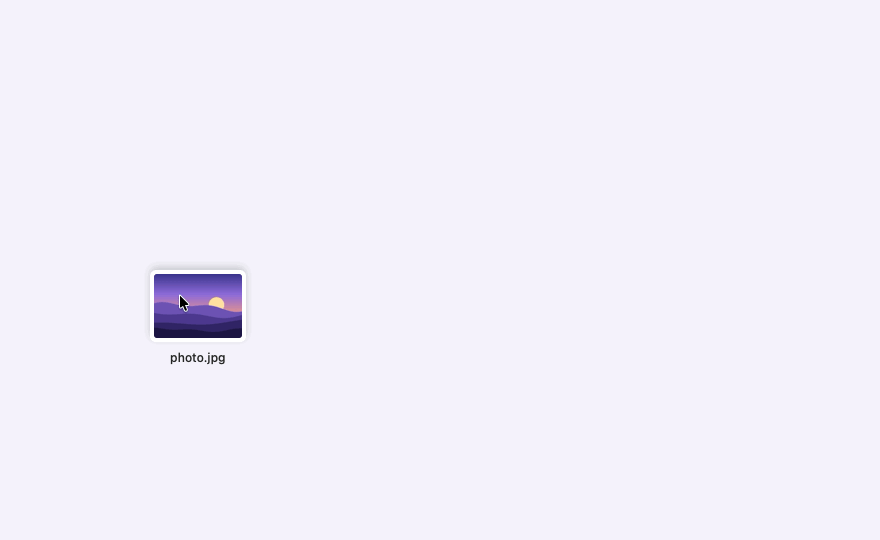
</p>

## Install

> **Open Source Project:** [GitHub Repository](https://github.com/abdallahqaraqe1/naqra).

### Mac

1. Download **[Naqra.dmg](https://github.com/abdallahqaraqe1/naqra/releases/latest/download/Naqra.dmg)** from the latest release.
2. Open it and drag **Naqra** into **Applications**.
3. Open **Naqra** from Applications. macOS shows *"Naqra" Not Opened*. Press **Done**, not Move to Trash.
4. Open **System Settings → Privacy & Security**, scroll down to **Security**, and press **Open Anyway** next to
   *"Naqra" was blocked to protect your Mac*.
5. Press **Open Anyway** again and enter your Mac password. Naqra opens, and macOS will not ask again.
6. Look for the wheel icon in the menu bar. The welcome guide lets you practice once.

<details>
<summary>Prefer Terminal? One command does steps 3 to 5</summary>

```bash
xattr -dr com.apple.quarantine /Applications/Naqra.app && open /Applications/Naqra.app
```

</details>

**Why does macOS ask?** Naqra is not notarized by Apple yet, so macOS asks once before opening any app
downloaded outside the App Store. The app is open source: you can read every line here, or build it yourself.
On macOS 14 Sonoma, **right-click → Open → Open** also works.

Requires macOS 14 Sonoma or later on Apple silicon.

### Windows

1. Download the installer for your PC from the latest release:
   - **[Naqra-Setup-x64.exe](https://github.com/abdallahqaraqe1/naqra/releases/latest/download/Naqra-Setup-x64.exe)** for most PCs (Intel or AMD).
   - **[Naqra-Setup-arm64.exe](https://github.com/abdallahqaraqe1/naqra/releases/latest/download/Naqra-Setup-arm64.exe)** for ARM PCs (Snapdragon, Surface Pro X…).

   Not sure? Open **Settings → System → About** and look at **System type**.
2. Open the installer. If Windows shows *Windows protected your PC*, press **More info**, then **Run anyway**.
   If your browser says the file is not commonly downloaded, choose **Keep**.
3. Pick **العربية** or **English**, then **Next** and **Install**. No administrator password is needed: Naqra
   installs for your account only.
4. Naqra starts next to the clock (look under the **^** arrow if the icon is hidden). The welcome guide lets you
   practice once.

**Why does Windows warn?** The installer is not code-signed yet, so SmartScreen does not know it. The app is open
source, and the SHA-256 of each installer is listed in the release notes.

Requires Windows 10 (version 1809) or Windows 11, 64-bit. Remove it any time from **Settings → Apps**.

<p align="center">
  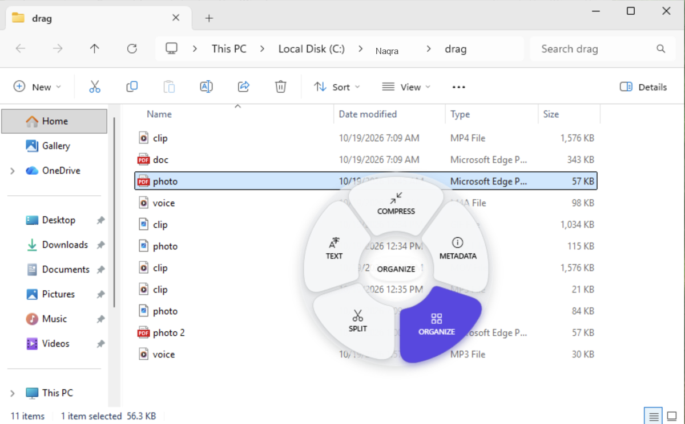<br>
  <sub>Naqra on Windows 11: the Tools wheel for a PDF, opened while dragging it from File Explorer</sub>
</p>

### Linux

Pick the download for your distribution from the latest release. Each comes for most PCs (x64) and for ARM64.

| Distribution | Download | Install |
| --- | --- | --- |
| Ubuntu, Debian, Linux Mint, Pop!_OS | [Naqra-linux-amd64.deb](https://github.com/abdallahqaraqe1/naqra/releases/latest/download/Naqra-linux-amd64.deb) | Double-click it, or `sudo apt install ./Naqra-linux-amd64.deb` |
| Fedora, openSUSE | [Naqra-linux-x86_64.rpm](https://github.com/abdallahqaraqe1/naqra/releases/latest/download/Naqra-linux-x86_64.rpm) | `sudo dnf install ./Naqra-linux-x86_64.rpm` |
| Any other | [Naqra-x86_64.AppImage](https://github.com/abdallahqaraqe1/naqra/releases/latest/download/Naqra-x86_64.AppImage) | Make it executable (`chmod +x`), then open it. Nothing to install. |

ARM64 files end in `Naqra-linux-arm64.deb`, `Naqra-linux-aarch64.rpm` and `Naqra-aarch64.AppImage`. The .deb and .rpm also install the tools
Naqra reads text and makes documents with (Tesseract, WeasyPrint, LibreOffice); with the AppImage, Naqra says
which one to install the first time a tool needs it.

1. Open **Naqra** from your apps. Its icon appears in the top bar, and the welcome guide lets you practice once.
2. **GNOME on Wayland** (Ubuntu, Fedora and most others today): sign out and back in once. Wayland lets no app
   watch drags, so Naqra brings a small GNOME Shell extension that tells it when you press a key during a drag;
   GNOME loads it at the next sign-in. On **X11** desktops the wheel works right away.
3. **Other Wayland desktops** (KDE Plasma, Hyprland, Sway…): right-click files and choose **Open with Naqra**
   to open the wheel. The menu item is added to Files, Dolphin, Nemo and Caja on every desktop.

Tested on Ubuntu 24.04 (GNOME on Wayland and on X11); it needs a 64-bit distribution with X11 or Xwayland. On GNOME, the top bar icon needs the
AppIndicator extension, which Ubuntu turns on by default (on Fedora, install `gnome-shell-extension-appindicator`).

### Android

Download [Naqra-Android.apk](https://github.com/abdallahqaraqe1/naqra/releases/latest/download/Naqra-Android.apk) on your phone or tablet (Android 10 or later) and open it.

1. If Android asks, tap **Settings**, turn on **Allow from this source**, then go back and tap **Install**.
2. If Play Protect warns you, tap **More details**, then **Install anyway**. Naqra is published here on GitHub
   only, not on Google Play.
3. Share any file and choose **Naqra**, or open a file with Naqra. The wheel appears: tap a choice, or slide your
   finger onto it and lift. The center of the wheel, or the tabs under it, switch between Convert, Tools and Actions.

Results are saved in an Naqra folder in Pictures, Movies, Music or Download. Every release is signed with the same
key, so an update installs over the previous one. The certificate's SHA-256 fingerprint is
`18:74:CF:62:E2:AD:6C:66:EB:87:C7:7A:01:26:18:D3:CA:58:D7:8C:6E:38:12:FE:5E:F8:50:30:B4:91:E1:0F`.

On Android, a PDF also becomes Word, Excel, PowerPoint and EPUB, and video saves as MP4, WebM or GIF. Old .doc and
.xls files and presentations do not open yet.

<table>
  <tr>
    <td align="center" width="33%">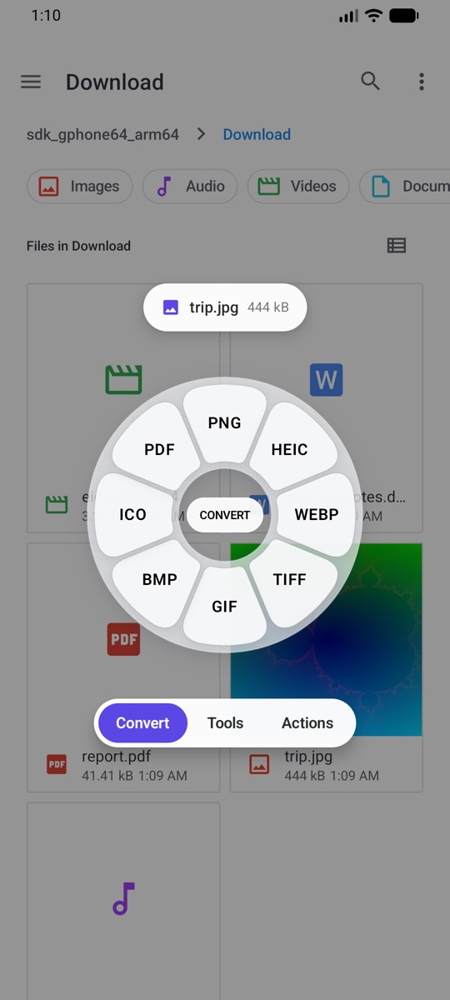<br><sub>The Convert wheel over the Files app</sub></td>
    <td align="center" width="33%">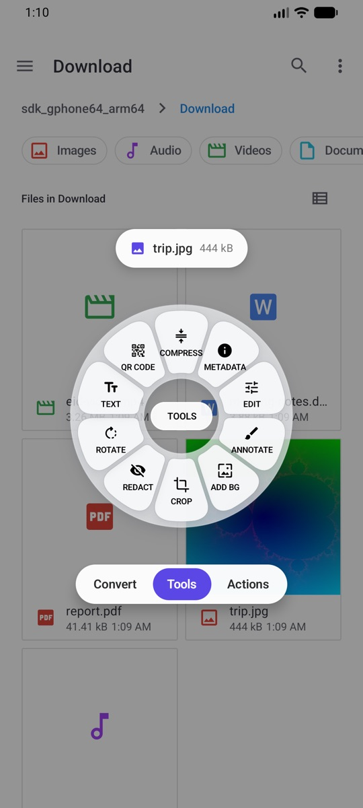<br><sub>The Tools wheel for the same photo</sub></td>
    <td align="center" width="33%">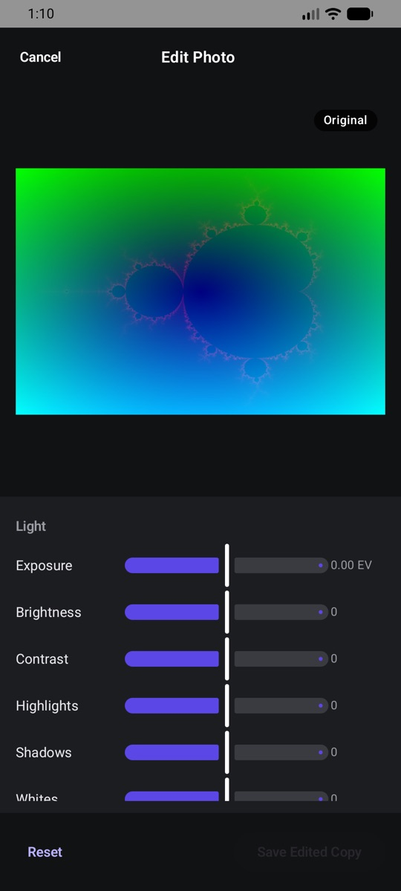<br><sub>The Edit Photo window</sub></td>
  </tr>
</table>

## How it works

1. **Drag** one or more files from Finder, File Explorer or your Linux file manager, the desktop, or any app.
2. **While dragging, press a key** to open its wheel. The wheel stays open until you drop.
3. **Drop** on a choice. The result is saved next to the original (or in Downloads or on the Desktop, as you prefer).

| Mac | Windows and Linux | Wheel | What's in it |
| :---: | :---: | --- | --- |
| <kbd>⇧ Shift</kbd> | <kbd>Shift</kbd> | **Convert** | Every format the file can become |
| <kbd>⌘ Command</kbd> | <kbd>Ctrl</kbd> | **Tools** | Compress, edit, crop, trim, organize, and more for that kind of file |
| <kbd>⌃ Control</kbd> | <kbd>Alt</kbd> | **Actions** | Share (AirDrop on Mac), Float, Copy, Move, Copy Path, open in Terminal |

The keys can be changed in Settings. Tools that need choices (Compress, Crop, Edit…) open a small window first;
the rest run as soon as you drop.

<table>
  <tr>
    <td align="center" width="50%"><br><sub>The Convert wheel for a photo</sub></td>
    <td align="center" width="50%"><br><sub>The Tools wheel for a photo</sub></td>
  </tr>
</table>

## What it can do

### Convert

| File | Becomes |
| --- | --- |
| **Images** (JPEG, PNG, HEIC, WebP, AVIF, TIFF, GIF, BMP, ICO, RAW…) | PNG · JPEG · HEIC · WebP · AVIF · TIFF · GIF · BMP · ICO · PDF, keeping HDR and color profiles |
| **Video** (MP4, MOV, MKV, WebM, AVI…) | MP4 · MOV · MKV · WebM · GIF · MP3 · M4A, copying streams without re-encoding when possible |
| **Audio** (MP3, M4A, WAV, FLAC, AIFF, OGG, Opus…) | MP3 · M4A · WAV · FLAC · AIFF · OGG · Opus |
| **PDF** | Word · Pages · PowerPoint · EPUB · Markdown · Text · PNG · JPEG |
| **Documents** (Word, Pages, RTF, HTML, Markdown, EPUB, ODT, Text) | PDF · Word · Pages · EPUB · Markdown · RTF · HTML · ODT · Text |
| **Spreadsheets** (Excel, Numbers, ODS, CSV, TSV) | Excel · ODS · CSV · TSV · PDF · HTML |
| **Presentations** (PowerPoint, Keynote, ODP) | PDF · Keynote · PNG · JPEG |
| **Subtitles** (SRT, VTT) | SRT · VTT · Text |
| **Archives** (ZIP, TAR, TGZ, GZ, RAR, 7Z…) | ZIP · TAR · TGZ, or extract |

On Windows the list is the same, with these differences: PDF also becomes **Excel**; HEIC opens but is not offered
as an output; Pages, Keynote and Numbers are Mac-only; and presentations need PowerPoint or LibreOffice installed.
Linux matches Windows; presentations, old Word files and Rich Text go through LibreOffice, text recognition through
Tesseract (Arabic and English), and PDFs are printed with WeasyPrint. Share offers email, Bluetooth and KDE Connect.

### Tools

- **Photos:** Compress (to a preset, a target size, or a percentage) · Edit (light, color, detail, effects) ·
  Annotate (arrows, text, shapes, highlights, numbered callouts, magnifier) · Add Background · Crop · Redact
  (detects faces and text) · Rotate · Copy Text (OCR, Arabic included) · Read QR Code · Edit or remove metadata ·
  Create PDF · Create Collage
- **PDF:** Compress · Merge · Organize pages (reorder, rotate, duplicate, delete) · Split · Copy Text (OCR) ·
  Remove metadata
- **Video:** Compress · Trim · Crop · Change speed · Save frames · Split into clips · Redact areas over time ·
  Join · Rotate · Mute · Normalize volume · Remove metadata
- **Audio:** Compress · Trim · Trim silence · Normalize loudness (two-pass, EBU R128) · Bleep sections ·
  Mono / stereo channels · Audio visualizer video · Remove metadata
- **QR codes:** create codes for text, links and Wi-Fi, with six dot shapes, four corner styles, gradients, a
  logo in the middle, and a live check that the code still scans. Exports PNG or SVG.

### Float

A small floating shelf for files. Drop files on it to keep them at hand, drag them out to any app, or attach it
to the edge of the screen. Results can open in a Float automatically.

<table>
  <tr>
    <td align="center" width="33%">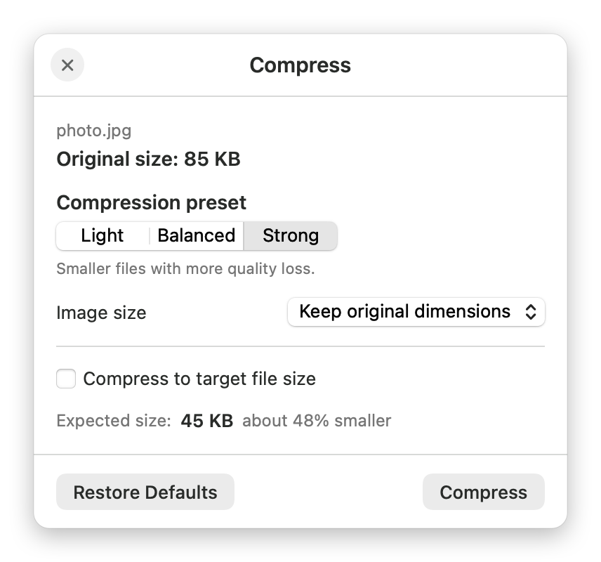<br><sub>Compress</sub></td>
    <td align="center" width="33%">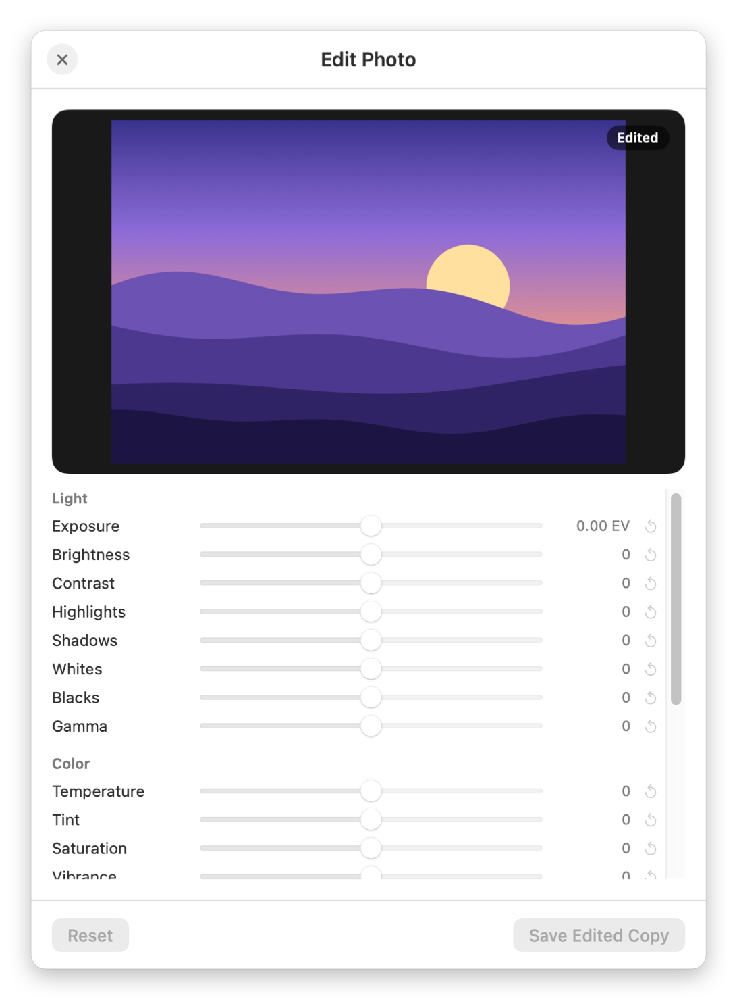<br><sub>Edit Photo</sub></td>
    <td align="center" width="33%">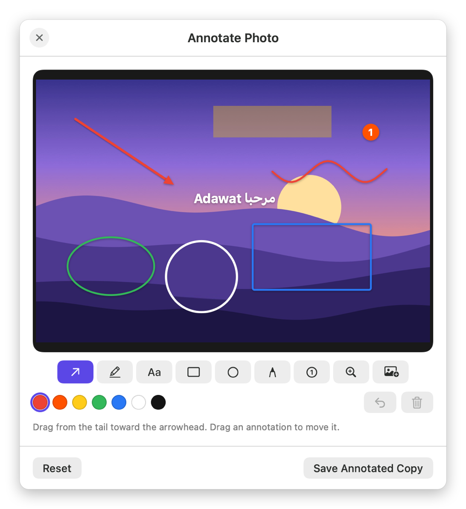<br><sub>Annotate</sub></td>
  </tr>
  <tr>
    <td align="center">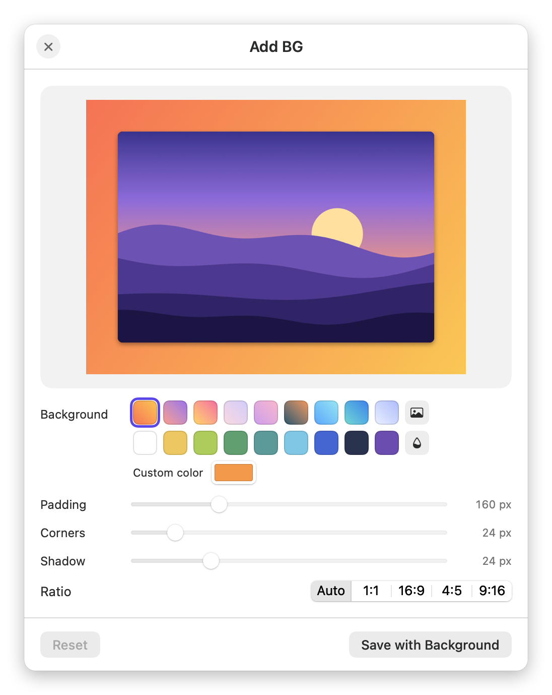<br><sub>Add Background</sub></td>
    <td align="center">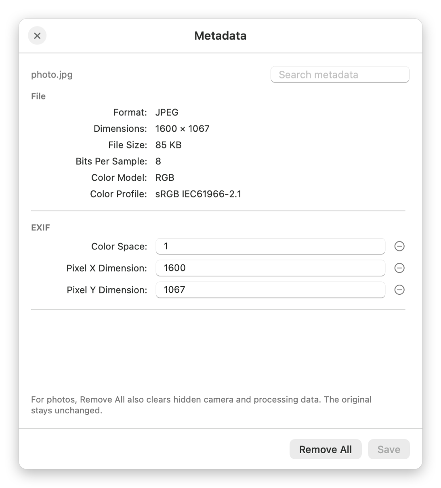<br><sub>Metadata</sub></td>
    <td align="center"><br><sub>Bleep Audio</sub></td>
  </tr>
  <tr>
    <td align="center" colspan="2">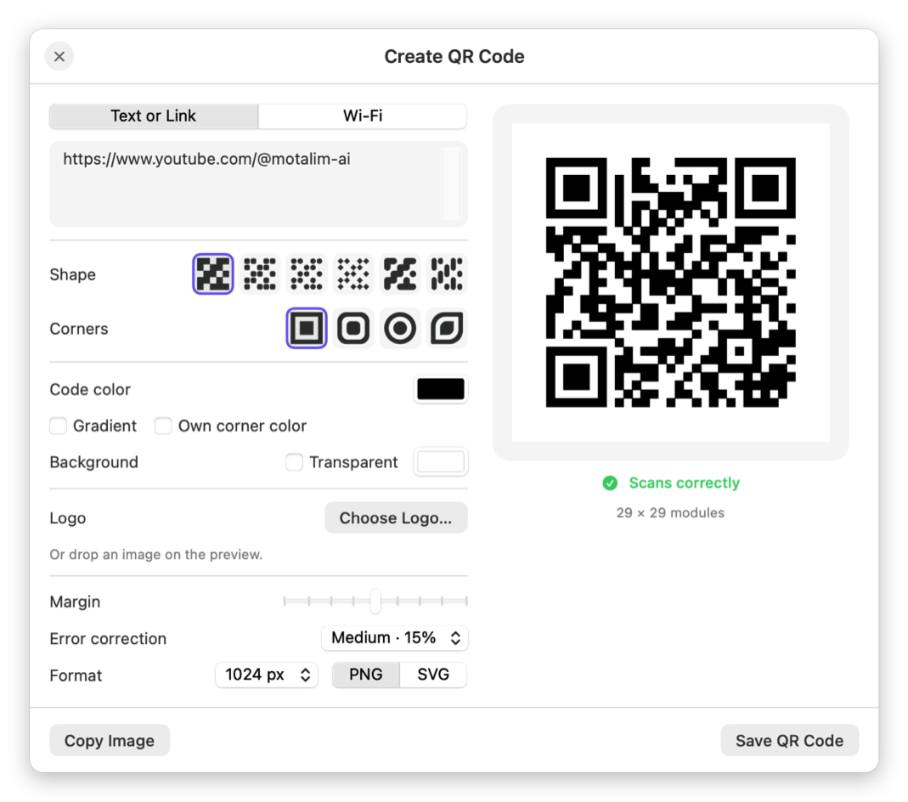<br><sub>Create QR Code</sub></td>
    <td align="center"><br><sub>The welcome guide</sub></td>
  </tr>
</table>

## Arabic and English

The whole interface is available in Arabic, right to left, and in English, on Mac, Windows, Linux and Android. Naqra follows
your system's language on first launch (on Windows, the language you pick in the installer), and you can switch
at any time in Settings.

## Build from source

You need Xcode 15.3 or later (or its command line tools), plus `cmake` and `pkgconf` for the bundled ffmpeg.

```bash
git clone https://github.com/abdallahqaraqe1/naqra.git
cd naqra
brew install cmake pkgconf
scripts/build-ffmpeg.sh            # builds the free, redistributable ffmpeg into build/ffmpeg (takes a few minutes)
scripts/build-app.sh --install     # builds build/Naqra.app and copies it to /Applications
```

`scripts/build-app.sh --dmg` also makes `build/Naqra-<version>.dmg`. The app runs without Homebrew: ffmpeg and
cwebp travel inside the app bundle.

### Windows

The Windows app is in `windows/`, written in C# with .NET 10 and WPF. It builds on Windows, or on a Mac with the
.NET 10 SDK.

```bash
windows/tools/fetch-ffmpeg.sh                                   # the pinned GPL ffmpeg for x64 and ARM64
dotnet build windows/src/Naqra.App/Naqra.App.csproj -c Release
windows/tools/build-installer.sh                                # Naqra-Setup-x64.exe and Naqra-Setup-arm64.exe
```

`build-installer.sh` publishes both versions and compiles `windows/installer/Naqra.iss` with
[Inno Setup 6](https://jrsoftware.org/isinfo.php) on a Windows machine it reaches over SSH (`NAQRA_WIN_HOST`).
`naqra-cli` runs any wheel choice from the command line, for testing: `naqra-cli list photo.jpg`,
`naqra-cli run image.webp photo.jpg`.

### Linux

The Linux app is in `linux/`, written in C# with .NET 10 and [Avalonia](https://avaloniaui.net), and shares
`windows/src/Naqra.Core` with the Windows app. It builds on Linux, or on a Mac with the .NET 10 SDK.

```bash
brew install nfpm squashfs                                     # on a Mac; on Linux, squashfs-tools and nfpm (nfpm.goreleaser.com)
linux/tools/build-packages.sh                                  # .deb, .rpm and AppImage for x64 and ARM64 in linux/build/packages
```

`linux/tools/deploy-vm.sh` runs a fresh build in a test machine's desktop session over SSH (host `naqra-linux`), and
`linux/tools/snapshots-vm.sh` renders every window there to pictures, in English or Arabic, for checking a build.

### Android

The Android app is in `android/`, written in Kotlin with Jetpack Compose. It needs JDK 17 and the Android SDK with
NDK 29 and CMake, which Android Studio installs.

```bash
android/tools/fetch-native.sh                                  # LAME, libarchive, xz and bzip2 sources, each checked by its SHA-256
cd android && ./gradlew assembleDebug                          # app/build/outputs/apk/debug/app-debug.apk
```

`./gradlew assembleRelease` signs the release APK when the Gradle properties `naqra.storeFile`,
`naqra.storePassword`, `naqra.keyAlias` and `naqra.keyPassword` are set, for example in `~/.gradle/gradle.properties`.

<details>
<summary>Project layout</summary>

| Path | What's there |
| --- | --- |
| `Sources/Naqra/App` | Menu bar, settings, welcome guide, command-line test modes |
| `Sources/Naqra/Wheel` | Drag watching and the radial wheel |
| `Sources/Naqra/Operations` | Every conversion and tool: images, media, PDF, documents, sheets, slides, archives, QR |
| `Sources/Naqra/Windows` | The option windows for tools |
| `Sources/Naqra/Float` | The Float shelf |
| `Resources` | App icon and translations (`ar.lproj`) |
| `scripts` | Build, ffmpeg, icon, banner, translation and screenshot scripts |
| `windows/src/Naqra.Core` | Windows: every conversion and tool, shared by the app and `naqra-cli` |
| `windows/src/Naqra.App` | Windows: tray icon, drag watching, the wheel, Floats and the option windows |
| `windows/src/Naqra.Cli` | Windows: the `naqra-cli` command line |
| `windows/installer`, `windows/tools` | Windows: the Inno Setup script, ffmpeg and installer scripts |
| `windows/shared` | Arabic translations for Windows and Linux, generated from `scripts/arabic.py` with the Mac's |
| `windows/src/Naqra.Core/Platform` | What differs between Windows and Linux in the shared core: OCR, PDF printing, clipboard, RTF |
| `linux/src/Naqra.Linux` | Linux: tray icon, drag watching (X11, or the GNOME Shell extension on Wayland), the wheel, Floats and the option windows |
| `linux/gnome-extension` | Linux: the GNOME Shell extension that reports drags under Wayland |
| `linux/packaging`, `linux/tools` | Linux: the .desktop file, package definitions, ffmpeg, model and build scripts |
| `android/app/src/main/java/com/abdallahqaraqe1/naqra` | Android: the wheel, the editors, and every conversion and tool |
| `android/app/src/main/cpp`, `android/tools` | Android: the bridges to LAME and libarchive, and the script that fetches their sources |

</details>

## Privacy

Naqra never sends your files anywhere, on Mac, Windows, Linux or Android. It has no analytics, no account and no network
features. On Mac, Pages, Keynote and Numbers are asked (with your permission) only when you convert their formats.

## License

Naqra is free software under the [GNU General Public License v3.0](LICENSE): you can use it, study it, share it
and change it. If you distribute a modified version, it has to stay free under the same license.
The bundled ffmpeg, cwebp, Windows and Android libraries keep their own licenses; see
[THIRD-PARTY-NOTICES.md](THIRD-PARTY-NOTICES.md).

The name **Naqra** and its icon identify this project and are not covered by the license.

## Developer: Eng. Abdallah Qaraqe


Naqra is an open-source project developed by **Eng. Abdallah Qaraqe**. Follow and contribute to the project on **[GitHub](https://github.com/abdallahqaraqe1/naqra)**. Also by [by-wow.com](https://by-wow.com).

Ideas, bugs or translations? [Open an issue](https://github.com/abdallahqaraqe1/naqra/issues).
